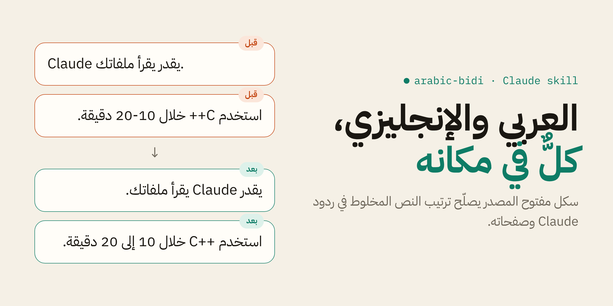
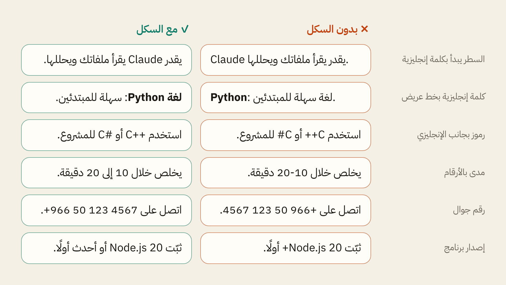

<div align="center">

<picture>
  <source media="(prefers-color-scheme: dark)" srcset="assets/banner-dark.png">
  
</picture>

<br>

[](LICENSE)
[](#التثبيت)
[](#في-claude-code)
[](#اللغات)

**[التثبيت](#التثبيت)** · **[قبل وبعد](#قبل-وبعد)** · **[الأسئلة الشائعة](#الأسئلة-الشائعة)** · **[English](#english)**

</div>

<div dir="rtl">

## المشكلة

إذا طلبت من Claude يكتب بالعربي وفي الجملة كلمة إنجليزية، ترتيب الجملة أحيانًا ينقلب:

- سطر يبدأ بكلمة مثل Claude أو Python يتحول كله لليسار، وتنقرأ الجملة بالمقلوب.
- الرموز في أسماء مثل ‎C++‎ و ‎C#‎ تنط للطرف الثاني، والمدى بين رقمين ينقلب.
- رقم الجوال تنعكس مجموعاته، والنقطة والأقواس تنط للطرف الثاني.
- في الصفحات اللي يبنيها Claude: محاذاة غلط، وخطوط ما تتناسق، وحروف عربية مقطّعة.

السبب مو خطأ في العربي. المتصفح يرتب النص حسب خوارزمية يونيكود للاتجاهين، وهي تقرر اتجاه السطر من أول حرف فيه، وتعامل الرموز والأرقام بطريقة ما يتوقعها الكاتب.

## الحل

سكل واحد تثبّته مرة، ويتعلّم منه Claude يكتب النص المخلوط بالطريقة اللي تنعرض صح:

| المكان | وش يسوي السكل |
|---|---|
| ردود المحادثة | يبدأ كل سطر بكلمة عربية، ويعيد صياغة الأرقام والرموز اللي تنقلب، أو يثبّتها بعلامة اتجاه غير مرئية |
| الصفحات والـ artifacts | يحدد اتجاه الصفحة، ويعزل الكلمات الإنجليزية، ويستخدم CSS منطقي، ويختار خطًا يغطي اللغتين |
| الرسوم البيانية و SVG | يضبط اتجاه الرسم والتسميات، لأنها ما تاخذ اتجاه الصفحة تلقائيًا |
| ملفات Word و PowerPoint و Excel | يفعّل الاتجاه من اليمين ويحط الخط العربي في مكانه الصحيح |
| الصور والفيديو والإيميل | قواعد خاصة لكل واحد منها |
| داخل Claude Code | فحص تلقائي لكل ملف يكتبه Claude، ويصلّح المشاكل قبل ما توصلك |

كل قاعدة في السكل مجرّبة فعليًا في المتصفح بنفس طريقة عرض تطبيقات المحادثة.

## قبل وبعد

<picture>
  <source media="(prefers-color-scheme: dark)" srcset="assets/before-after-dark.png">
  
</picture>

نفس المعلومة في العمودين، والفرق فقط في طريقة الكتابة. للتجربة بنفسك افتح الملف [`examples/demo.html`](examples/demo.html) في المتصفح.

## التثبيت

### في تطبيق Claude (الويب وسطح المكتب)

1. نزّل ملف `arabic-bidi.zip` من صفحة [Releases](../../releases/latest).
2. افتح **Customize** ثم **Skills**، واضغط **Add** وارفع الملف.
3. فعّل السكل من نفس الصفحة.

يحتاج السكل إن ميزة تنفيذ الأكواد (Code execution) تكون مفعّلة في حسابك.

### في Claude Code

```
/plugin marketplace add baraadb/arabic-bidi
/plugin install arabic-bidi@arabic-bidi
```

هذا يثبّت السكل مع الفحص التلقائي. ولو تبي السكل بدون الفحص، انسخ المجلد:

```
cp -r skills/arabic-bidi ~/.claude/skills/
```

### لتطبيق القواعد على كل رد (اختياري)

انسخ النص الموجود في [`preferences-snippet.md`](preferences-snippet.md) إلى تفضيلاتك الشخصية في تطبيق Claude، أو إلى ملف `CLAUDE.md`. السبب موضّح في الأسئلة تحت.

## الأسئلة الشائعة

<details>
<summary><b>أثبّته وخلاص تنحل المشكلة؟</b></summary>

<br>

في أغلب الحالات نعم:

- **في الصفحات والملفات:** يستدعي Claude السكل لما يبني أي صفحة أو ملف فيه عربي، والنتيجة مضبوطة.
- **في Claude Code:** الفحص التلقائي يراجع كل ملف بعد ما ينكتب، فحتى لو فاتت قاعدة ينبّه Claude ويصلّحها.
- **في ردود المحادثة:** يستدعي Claude السكل إذا الرد فيه عربي وإنجليزي، لكن الردود القصيرة والسريعة ممكن تفوته. للضمان أضف النص المختصر للتفضيلات، وهو سطور قليلة تنطبق على كل رد.

</details>

<details>
<summary><b>ليش ما يقدر يصلّح كل شيء؟</b></summary>

<br>

السكل يغيّر طريقة كتابة Claude، لكن طريقة العرض نفسها بيد التطبيق أو المتصفح. فالسكل يكتب النص بشكل ينعرض صح في أي مكان يتبع المعايير، وهذا يغطي أغلب الحالات. بعض الطرفيات (Terminal) ما تدعم العربي أصلًا، وهذي ما لها حل من جهة الكتابة.

</details>

<details>
<summary><b>وش هي العلامة غير المرئية؟</b></summary>

<br>

حرف في يونيكود اسمه LRM، ما ينشاف، ويخبر المتصفح إن الكلمة اللي جنبه إنجليزية. السكل يستخدمه حول كلمات مثل ‎C++‎ ويتجنبه داخل الأكواد والروابط، لأنه ينسخ معها ويخربها.

</details>

<details>
<summary><b>هل يأثر على ردود Claude بالإنجليزي؟</b></summary>

<br>

لا. القواعد تنطبق بس لما يكون فيه نص عربي أو بلغة ثانية تُكتب من اليمين.

</details>

## اللغات

العربية هي الأساس، والسكل يدعم كذلك:

- **الفارسية:** الفاصل الخفي بين أجزاء الكلمة، والحروف الفارسية بدل العربية المشابهة، والأرقام.
- **الأردية:** خط النستعليق وارتفاع السطر المناسب له.

## أداة الفحص

السكل فيه سكربت يفحص أي ملف ويطلع المشاكل مع رقم السطر وطريقة الحل:

```
python3 skills/arabic-bidi/scripts/check_bidi.py file.html
```

يشتغل على ملفات Markdown و HTML و SVG، وما يحتاج تثبيت أي مكتبة.

## محتويات المستودع

```
skills/arabic-bidi/
├── SKILL.md                         القواعد الأساسية
├── references/
│   ├── artifacts.md                 الصفحات والرسوم البيانية
│   ├── other-formats.md             ملفات المكتب والصور والفيديو والإيميل
│   └── persian-urdu-hebrew.md       الفارسية والأردية والعبرية
└── scripts/check_bidi.py            أداة الفحص
hooks/                               الفحص التلقائي
examples/demo.html                   صفحة قبل وبعد
preferences-snippet.md               النسخة المختصرة للتفضيلات
```

## المساهمة

لقيت جملة تنقلب وما يغطيها السكل؟ افتح [Issue](../../issues/new) وأرفق:

1. النص كما كتبه Claude.
2. صورة لشكله بعد العرض.
3. اسم التطبيق أو المتصفح.

ونرحب بأي تحسين على القواعد أو أداة الفحص عبر Pull Request.

## الحقوق

جميع الحقوق © 2026 [Baraa Adel](https://github.com/baraadb). المشروع منشور برخصة [MIT](LICENSE): تقدر تستخدمه وتعدّل عليه وتشاركه بحرية، بشرط تبقى معلومات الحقوق والرخصة مع أي نسخة.

</div>

---

## English

**arabic-bidi** is an open-source skill that makes Claude write mixed Arabic + English text that displays in the right order, in chat replies, artifacts, HTML, SVG, charts and documents.

**What it covers**
- **Chat replies:** every Arabic line starts with an Arabic word; symbols that flip (`C++`, `C#`, `.NET`, `10-20`, `+966 50…`, `-15%`, `$49`) are rephrased or wrapped in an invisible LRM mark. Every rule was verified in Chromium with `dir="auto"`, the way chat apps render.
- **Artifacts:** `dir="rtl"`, `<bdi>` isolation, `dir="auto"` for dynamic text, logical CSS, one font for both scripts, canvas and chart RTL options.
- **Other formats:** Word, PowerPoint, Excel, PDF, Pillow images, ffmpeg/ASS captions, HTML email, Mermaid.
- **Languages:** Arabic, Persian (ZWNJ, Persian letters and digits), Urdu (Nastaliq), Hebrew.
- **Automatic check in Claude Code:** a hook runs the checker on every file Claude writes and sends problems back so Claude fixes them.

**Install**
- Claude app: download `arabic-bidi.zip` from [Releases](../../releases/latest), then **Customize → Skills → Add**. Requires code execution to be enabled.
- Claude Code: `/plugin marketplace add baraadb/arabic-bidi`, then `/plugin install arabic-bidi@arabic-bidi`.
- Always-on chat rules: add [`preferences-snippet.md`](preferences-snippet.md) to your personal preferences or `CLAUDE.md`, since skills load only when Claude judges them relevant.

**Contributing:** open an [issue](../../issues/new) with the text, a screenshot of how it displays, and the app or browser.

© 2026 [Baraa Adel](https://github.com/baraadb). Released under the [MIT License](LICENSE).
